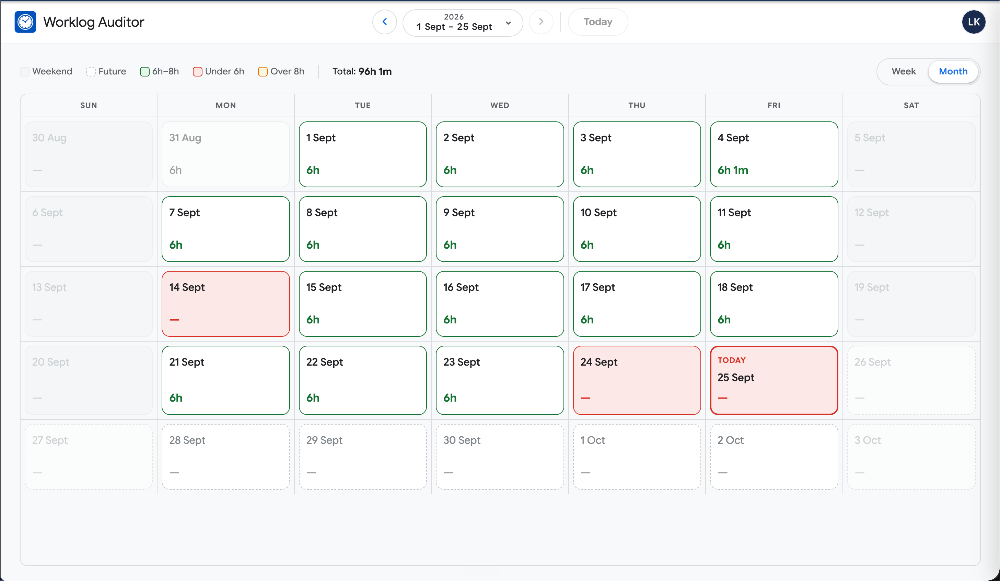
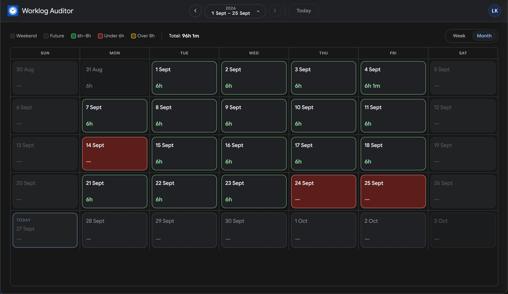
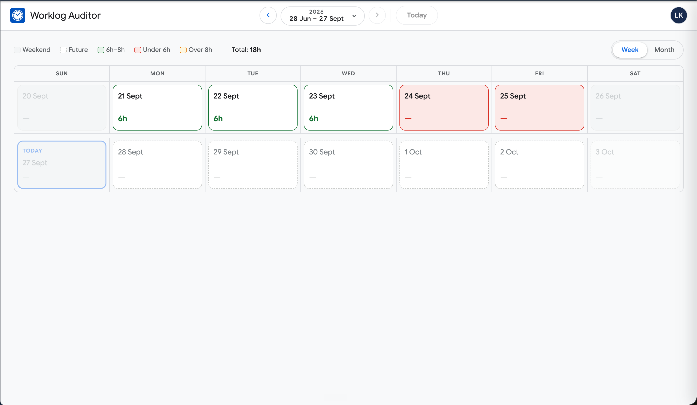
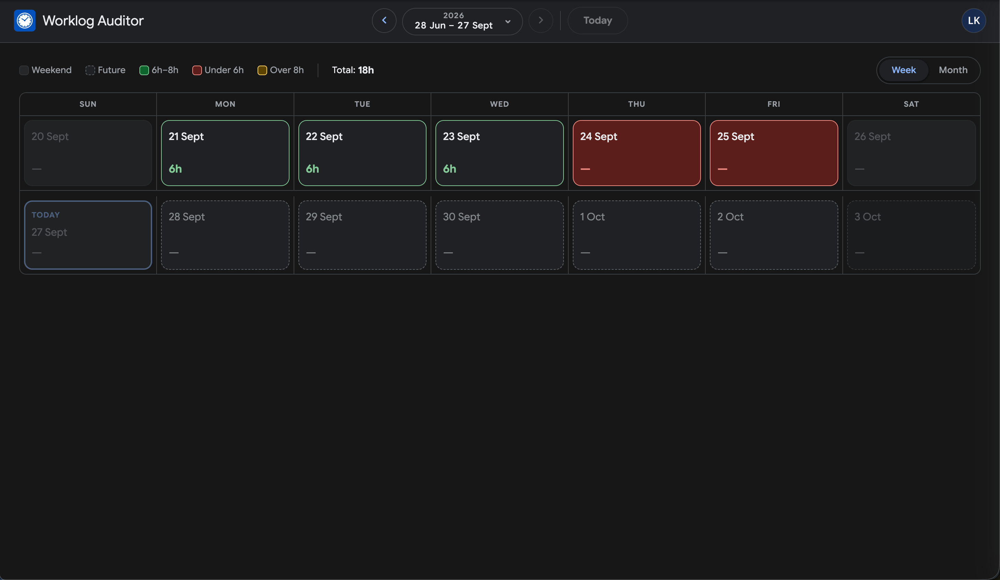
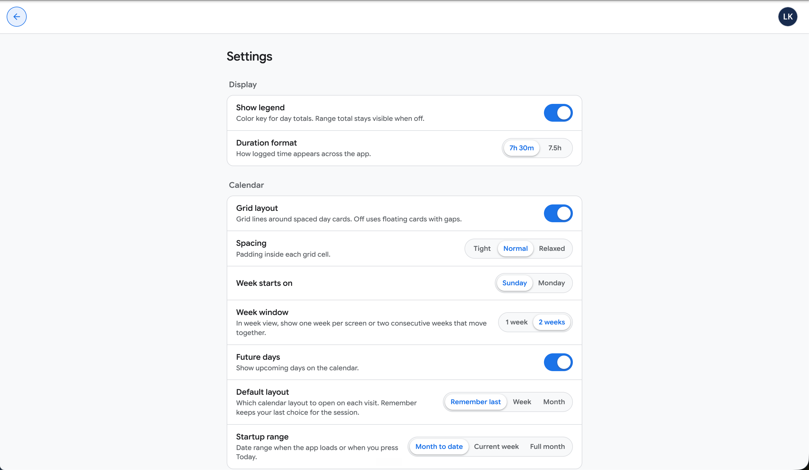

# Jira Assistant

Jira Assistant is a personal, local-first app for working with Jira Cloud. Its first available feature is **Worklog Auditor**, a calendar for reviewing your logged time. The feature roadmap below distinguishes what is available today from what is planned. It is available under the [MIT License](LICENSE).

## Features

| Feature                                                                       | Description                                                                                                                                | Status |
| ----------------------------------------------------------------------------- | ------------------------------------------------------------------------------------------------------------------------------------------ | ------ |
| Worklog Auditor                                                               | Review Jira worklogs in month and week calendar views, choose a date range, audit daily totals, and inspect worklog details and estimates. | ✅     |
| [CSV Export](https://github.com/lalitmee/jira-assistant/issues/1)             | Export worklogs from the selected calendar date range to CSV.                                                                              | ⏳     |
| [My Issues Dashboard](https://github.com/lalitmee/jira-assistant/issues/2)    | View assigned Jira issues with status, priority, due date, and links to Jira.                                                              | ⏳     |
| [Sprint Worklog Summary](https://github.com/lalitmee/jira-assistant/issues/3) | Summarize your logged time by sprint and issue, with estimates where available.                                                            | ⏳     |

✅ Available · ⏳ Planned. Select a planned feature to open its tracking issue.

## Screenshots

<details>
<summary>View Worklog Auditor screenshots</summary>

### Month calendar

| Light theme                                                                                 | Dark theme                                                                                |
| ------------------------------------------------------------------------------------------- | ----------------------------------------------------------------------------------------- |
|  |  |

### Week calendar

| Light theme                                                                            | Dark theme                                                                           |
| -------------------------------------------------------------------------------------- | ------------------------------------------------------------------------------------ |
|  |  |

### Settings



</details>

## Setup

1. Create an Atlassian **OAuth 2.0 (3LO)** app ([Developer console](https://developer.atlassian.com/console/myapps/)).
2. Choose **Resource** access (site-restricted). Keep distribution **Not sharing**.
3. Authorization callback URL:

   `http://localhost:8888/auth/callback`

4. Permissions → Jira API → enable scopes used by the app:
   - `read:jira-work`
   - `read:jira-user`
   - `offline_access`
5. Copy Client ID + Secret from Settings.
6. Copy `.env.example` to `.env` and fill in your Atlassian OAuth values.

The callback in the Atlassian console must match `ATLASSIAN_REDIRECT_URI` exactly. If you change `API_PORT`, update that URI in both places. For direct production runs, also set `WEB_ORIGIN` to `http://localhost:<your-port>`; for Docker, update the published port and callback in `docker-compose.yml`.

## Run

```bash
yarn install
yarn dev
```

- Web: http://localhost:5173
- API: http://localhost:8888 (listens on this computer only)

Open the web URL → **Connect to Jira** → pick a date range → review day totals and worklog details.

## Production (always-on, no Docker)

Single URL on port 8888 — same as the Docker setup, runs directly on your Mac:

```bash
yarn prod
```

Open **http://localhost:8888** (not 5173 — that is dev-only). Stop `yarn dev` first if it is running.

Or build once, then start:

```bash
yarn build
yarn start:prod
```

- App: http://localhost:8888
- Sessions persist in `./.data`
- The API listens on `127.0.0.1` by default, so other devices cannot connect directly.
- Re-run `yarn prod` after code changes (builds automatically)

Run in the background:

```bash
nohup yarn start:prod >> .data/prod.log 2>&1 &
```

Stop with `kill` on that process, or `pkill -f "node apps/api/dist/index.js"`.

## Docker (always-on, single port)

Build and run in the background:

```bash
docker compose up -d --build
```

- App: http://localhost:8888
- OAuth callback stays `http://localhost:8888/auth/callback` (same as `.env.example`)
- Sessions persist in `./.data` on your machine (mounted into the container)
- Docker publishes port 8888 on the host's `127.0.0.1` only. The API listens on all interfaces **inside the container** so Docker can forward that local connection.

Useful commands:

```bash
docker compose logs -f    # follow logs
docker compose down       # stop
docker compose up -d --build   # rebuild after code changes
```

For active development with hot reload, use `yarn dev` instead.

## Stack

- `apps/web` — Vite + React
- `apps/api` — Hono (OAuth, session cookie, Jira proxy)
